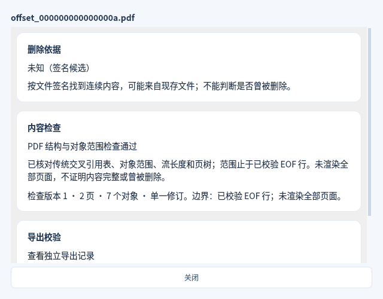

# v0.9.0 PDF 扫描与静态预览测试

日期：2026-11-05（北京时间）。本轮为开发 PR，尚未发布 v0.9.0，当前下载仍是 v0.8.0。M5 实机按要求跳过，继续标记未执行。

新增传统交叉引用 PDF 的范围检查、文档筛选和分页/缩放预览，并接通既有校验导出与历史。静态支持边界、候选 EOF 范围和资源限制见[PDF 说明](PDF_PREVIEW.md)。

## 验证结果

Linux x86_64 / Python 3.12 / PySide6 6.8.3：全量 **493/493 通过、0 跳过**，其中本轮新增 46 项核心与界面测试。新 PDF Qt 工作流 **8/8 通过、9 张截图**，使用两页原创合成 PDF；另验证了 Qt 自己生成的含嵌入字体 PDF。[完整测试门禁](qa/pdf-20261105/linux/test-report.json)、[界面证据](qa/pdf-20261105/linux/evidence.json)。

Windows x64、macOS Apple Silicon / Intel 原生测试、编译、实际打包启动及新 PDF 工作流待执行，结果在本 PR 内补齐。未完成的构建不计为通过。

## 核心覆盖

- 头部跨块、绝对偏移、精确 EOF、相邻 PDF、流内伪 startxref/EOF、间接 Length、xref 错位/对象身份、未索引/重叠对象、页树计数/循环/父引用及缺失对象。
- 加密、转义名称下的活动内容、表单、附件、外部文件/URL、对象流/交叉引用流和增量修订分别受限；普通字符串中的 `/JavaScript` 等文字不误报活动内容。
- 文件/对象/语法/页数/字符串/嵌套/解压预算、无最终换行的合法 EOF、截断、分区边界与取消；400 次可重复元数据突变不出现未处理异常。
- 普通镜像与电脑分区扫描、授权 Android 副本、iPhone 扩展名缺失 blob、元数据已知的碎片范围顺序，来源只读、摘要校验、源变化拒绝及历史源缺失。
- 实际子进程渲染两页不同像素与缩放；取消、超时、内存阈值和异常协议会结束子进程；UI 停止/重试、改选/导航/新任务/退出释放数据并清除旧画面。
- 原始盘预检拒绝发生在数据库预览任务和渲染器启动之前；精确范围导出及源/目标摘要、候选状态保留、文档过滤和历史回读。

打包冒烟增加 PDF 专用门禁：在冻结程序中实际启动 PDF 工作进程（含 Windows windowed 管道）、扫描→两页解码→缩放→释放→校验导出→工作目录切换后的历史回读。门禁报告须提供 pdf_scan_verified、pdf_preview_verified、pdf_worker_verified、pdf_buffer_released、2 页和 1 项导出。

开发测试发现并修正：PDFium 虚拟地址预留不能直接视为驻留内存；伪 EOF（包括伪交叉引用流）的错误偏移不能提前屏蔽后续有效 EOF；字体资源名 A 不应被误认为动作；EOF 无最终换行属于合法布局。相关测试已覆盖。运行器内部内存采样与超时不替代所有原生库分配的硬配额。

## 关键截图

下图为未编辑的合成数据截图；不是从用户数据提取的文件。

M5 真实手机、备份、介质及安装体验未执行，不据此计算删除恢复成功率。Windows 原有两项路径替换/符号链接测试沿用明确跳过，不新增 PDF 跳过。
