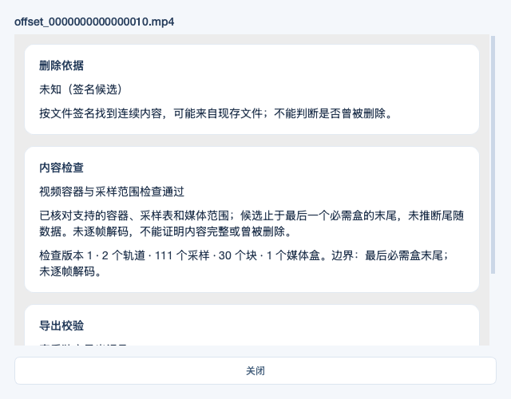
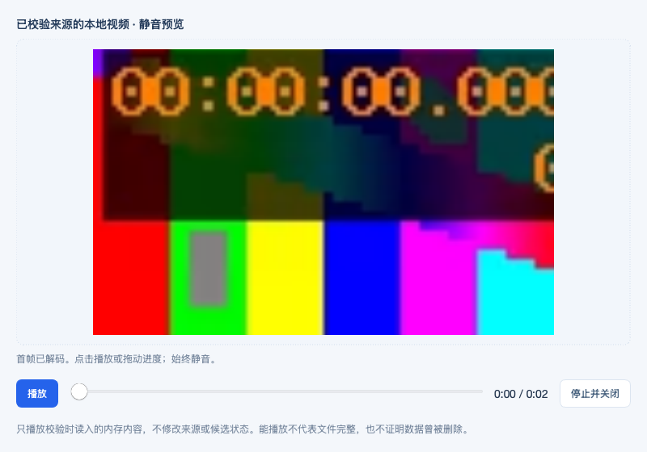

# v0.8.0 视频签名扫描测试

日期：2026-11-05（北京时间）。PR #18 和发布说明 PR #19 已合并，v0.8.0 标签的三平台正式构建已通过；发布受外部计费/认证问题阻断，现有下载仍为 v0.7.0。

本轮新增 MP4/MOV 连续签名定位、容器与采样范围检查，并接通筛选、既有静音预览、校验导出及历史回读。检查范围和原文件边界限制见[使用说明](VIDEO_SIGNATURE_SCAN.md)。

## 正式标签构建与发布状态

正式源提交为 `bb14d60944270a3da4fece96718fdd5f54f1adb3`。三平台均从 v0.8.0 标签构建，应用代码与已验证的 PR #18 一致，PR #19 仅补齐发布说明。

[正式运行](https://github.com/Ren-ZH-007/DeepRecover/actions/runs/41977483255)的 Windows、Apple Silicon、Intel 原生任务均通过；Windows 445 项通过、2 项既有跳过，macOS 双架构各 447 项通过。打包后的扫描、实际解码、精确导出和历史回读通过，已核验 3 个 ZIP 的 SHA-256、CRC、版本与架构，以及 163 张工作流截图和 2 张打包 Cocoa 截图。

自动发布任务及一次仅重试发布作业均未分配到运行器，GitHub 注释为账户付款失败或需提高支出额度；当前环境备用上传的 `uploads.github.com` 返回 401。v0.8.0 Release 尚未创建，未将失败发布记录为成功。源标签及通过验证的构建产物保持原样，账号问题修复后可仅重试该运行的失败发布任务。

原始报告、打包冒烟、新流程截图、各平台构建下载链接及过期时间见[发布状态](releases/0.8.0/STATUS.json)及该目录的 `validation`。构建附件受 GitHub 保留期限限制，不替代正式 Release 下载。下方保留发布前 PR 的证据。

## 验证范围

- 自动化覆盖：真实 H.264/AAC MP4、尾部 `moov` 的 MOV、32/64 位盒与偏移、多 `mdat`、跨所有块边界、采样/时钟/分组一致性、伪造范围/重叠、父盒边界、资源上限、取消，以及 400 次可重复元数据突变检查。
- 集成覆盖：源只读与摘要不变、绝对偏移与长度、计算机来源范围、分页与视频筛选、真实预览输入、精确范围导出及双摘要、源变化/缺失拒绝、历史回读。
- 新增 8 项 Qt 界面流程：选择来源并扫描、视频筛选/依据、MP4/MOV 实际帧解码、双文件校验导出、电脑扫描相同范围、不支持状态区分、5 项不合格导出拒绝、源缺失后历史回读。共 8 张关键截图。
- 打包冒烟新增门禁：实际执行视频扫描，核对范围/摘要，导出后核对字节，再经 Qt 解码、播放/拖动、释放内存设备，切换工作目录后回读候选与导出记录。

## 运行结果

Linux x86_64 / Python 3.12 / PySide6 6.8.3：全量 **447/447 通过，0 跳过**，其中新增 30 项核心与界面测试。新 Qt 工作流 **8/8 通过、8 张截图**。见[测试门禁报告](qa/20261105-video-signature/linux/test-report.json)和[界面证据](qa/20261105-video-signature/linux/evidence.json)。

原生验证全部通过，功能提交 `34e231584472fdcdbb331cdc2d1904c26da3c43c`。Windows 构建该提交，macOS 构建 PR 临时合并提交 `4488ecb653d93d702e219f9f47f770af09863d97`，其父提交为当时 main `806447c` 与该功能提交。后续证据提交仅补充文档与截图。[构建对应记录](qa/20261105-video-signature/build-provenance.json)。

| 平台 | 全量自动化 | 界面工作流 / 截图 | 打包验证 |
|---|---|---|---|
| Windows x64 | 445 通过 / 2 项已知跳过 | 35 / 41 | EXE 实际启动、扫描视频、解码及导出通过 |
| macOS Apple Silicon | 447 通过 / 0 跳过 | 49 / 61 | 原生 `.app`，offscreen / Cocoa 冒烟与退出通过 |
| macOS Intel | 447 通过 / 0 跳过 | 49 / 61 | 原生 `.app`，offscreen / Cocoa 冒烟与退出通过 |

- [Windows 运行与构建附件](https://github.com/Ren-ZH-007/DeepRecover/actions/runs/41975529355)、[macOS 双架构运行与构建附件](https://github.com/Ren-ZH-007/DeepRecover/actions/runs/41975535337)。这些是 PR 预览构建，尚未创建 v0.8.0 Release。
- 已下载并核验 3 个 ZIP：SHA-256 与清单一致、CRC 正确，PE/Mach-O 架构与应用版本符合要求；macOS 可执行权限与框架符号链接存在。[安装包核验记录](qa/20261105-video-signature/packages-verification.json)。macOS 仍为 ad-hoc 签名，未进行 Developer ID 签名或公证。
- 已核验 163 张原生工作流截图和 2 张打包 Cocoa 截图的 PNG、SHA-256 与解码尺寸，并核对所有工作流结果、字形覆盖、来源只读及新打包门禁。[完整原生证据汇总](qa/20261105-video-signature/native-verification.json)。
- 本轮新增视频签名流程在 Linux 和三种原生构建各 8 项、各 8 张截图，分平台保留：[Linux](qa/20261105-video-signature/linux/evidence.json)、[Windows](qa/20261105-video-signature/windows-x64/evidence.json)、[Apple Silicon](qa/20261105-video-signature/macos-arm64/evidence.json)、[Intel](qa/20261105-video-signature/macos-x86_64/evidence.json)。其余工作流图片可从对应 CI 附件回读。

开发复核时修正了一个分类缺陷：零采样偏移原本显示资源受限，现归为视频结构失败。已补充精确断言，30 项本轮测试和最终 447 项全量回归通过。

关键节点（合成数据，未编辑截图；原生 Apple Silicon）：

## 保留的边界

容器/采样范围检查不解码全部比特流；实际首帧、播放和拖动不证明全片完整。测试使用合成视频和镜像，未访问真实原始磁盘或网络媒体，不能代表真实删除恢复成功率。原始盘隔离、M5 实机、真实手机/备份、长视频和不同硬件解码器仍需各自验收。Windows 两项已知路径替换/符号链接测试沿用受系统语义限制的明确跳过，不增加新跳过。
