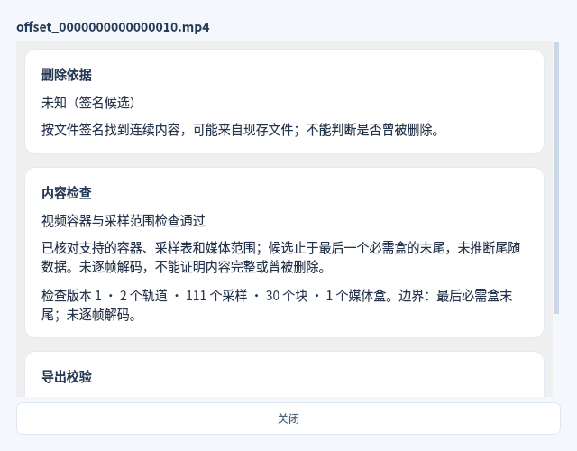
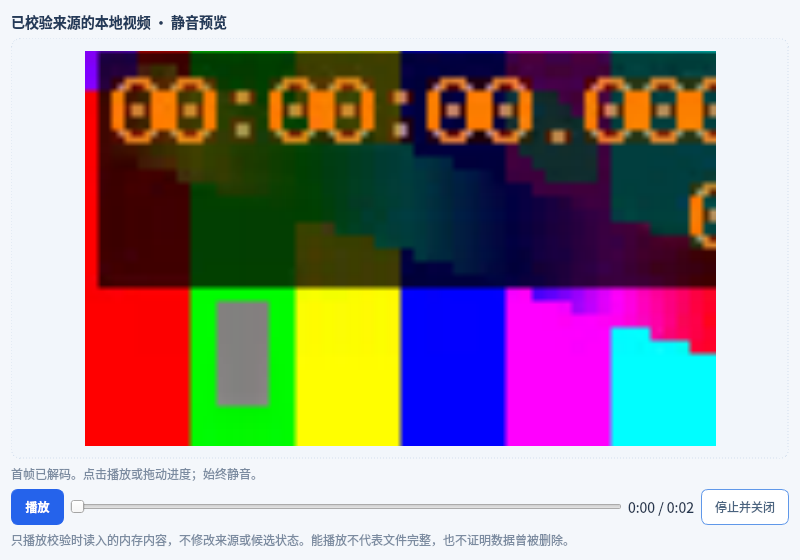

# v0.8.0 视频签名扫描测试

日期：2026-11-05（北京时间）。当前为开发 PR，尚未发布 v0.8.0；现有下载为 v0.7.0。

本轮新增 MP4/MOV 连续签名定位、容器与采样范围检查，并接通筛选、既有静音预览、校验导出及历史回读。检查范围和原文件边界限制见[使用说明](VIDEO_SIGNATURE_SCAN.md)。

## 验证范围

- 自动化覆盖：真实 H.264/AAC MP4、尾部 `moov` 的 MOV、32/64 位盒与偏移、多 `mdat`、跨所有块边界、采样/时钟/分组一致性、伪造范围/重叠、父盒边界、资源上限、取消，以及 400 次可重复元数据突变检查。
- 集成覆盖：源只读与摘要不变、绝对偏移与长度、计算机来源范围、分页与视频筛选、真实预览输入、精确范围导出及双摘要、源变化/缺失拒绝、历史回读。
- 新增 8 项 Qt 界面流程：选择来源并扫描、视频筛选/依据、MP4/MOV 实际帧解码、双文件校验导出、电脑扫描相同范围、不支持状态区分、5 项不合格导出拒绝、源缺失后历史回读。共 8 张关键截图。
- 打包冒烟新增门禁：实际执行视频扫描，核对范围/摘要，导出后核对字节，再经 Qt 解码、播放/拖动、释放内存设备，切换工作目录后回读候选与导出记录。

## 运行结果

Linux x86_64 / Python 3.12 / PySide6 6.8.3：全量 **447/447 通过，0 跳过**，其中新增 30 项核心与界面测试。新 Qt 工作流 **8/8 通过、8 张截图**。见[测试门禁报告](qa/20261105-video-signature/linux/test-report.json)和[界面证据](qa/20261105-video-signature/linux/evidence.json)。

原生 Windows/macOS 构建验证待执行；最终结果与运行链接将在本 PR 内补齐，未完成的构建不记为通过。

关键节点（合成数据，未编辑截图）：

## 保留的边界

容器/采样范围检查不解码全部比特流；实际首帧、播放和拖动不证明全片完整。测试使用合成视频和镜像，未访问真实原始磁盘或网络媒体，不能代表真实删除恢复成功率。原始盘隔离、M5 实机、真实手机/备份、长视频和不同硬件解码器仍需各自验收。Windows 两项已知路径替换/符号链接测试沿用受系统语义限制的明确跳过，不增加新跳过。
